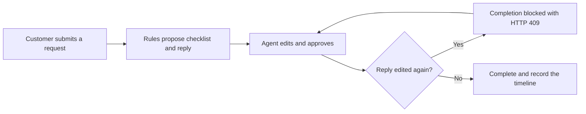

# Customer Request Desk

**A support agent approves a reply, then edits it. Can the ticket still be closed?** This local demo clears approval on edit. Trying to complete the ticket now returns **HTTP 409**. Once the revised reply is approved, the ticket closes and the history remains available after refresh.

| Input | What the agent receives | What the system records |
| --- | --- | --- |
| A customer submits a pricing inquiry, login issue, or order complaint | A category, checklist, and editable reply draft from a rule-based simulator | A ticket ID, the approved reply, and a timeline of changes in SQLite |

The demo focuses on the approval workflow and its failure paths. Replies stay inside the app. The suggested reply comes from deterministic rules. The data is fictional.

## Follow one ticket



1. Submit a request and keep the ticket ID.
2. In the staff workspace, analyze the ticket, edit the draft, approve it, and start processing.
3. Save another edit and try to complete the ticket. The API rejects completion until you approve the new draft.
4. Approve the revision and complete the ticket. Refresh to see the persisted reply and timeline.

[See the running Vietnamese interface](docs/screenshots/workspace.png) · [See the blocked completion](docs/screenshots/reapproval-required.png) · [See the completed ticket](docs/screenshots/approved-request.png)

## Run locally

On Windows, install Node.js 24 or newer, extract the repository, and double-click [`start.bat`](start.bat). Open [the local app](http://127.0.0.1:3000). Load sample data from the staff workspace or submit a fictional request of your own. Loading samples again replaces prior samples and preserves manually submitted tickets.

```bash
npm ci
npm run dev
```

## Where the workflow is enforced

| Component | Responsibility |
| --- | --- |
| [Ticket API](app/api/tickets/route.ts) | Validates new requests and returns a ticket ID |
| [Transition API](app/api/tickets/%5Bid%5D/route.ts) | Clears approval on edit, checks approval before completion, and locks completed tickets |
| [Analysis provider](lib/ai.ts) | Generates deterministic suggestions behind the server-side provider interface |
| [SQLite store](lib/store.ts) | Persists ticket content, status, and history |
| [API verification](scripts/verify.mjs) | Exercises bad inputs, approval guards, history, and sample data preservation |

```bash
npm test
npm run typecheck
npm run build
```

The browser checks cover submission, approval, completion, and layout at five viewport widths. The API verification script creates tickets. Point the server to a disposable database with `TICKET_DB` and set `BASE_URL` for the script. [Detailed reviewer guide in Vietnamese](docs/REVIEW-GUIDE.md)

The app binds to loopback. It has no authentication, email delivery, CRM connection, or production deployment. Concurrent edits currently use last-write-wins.
