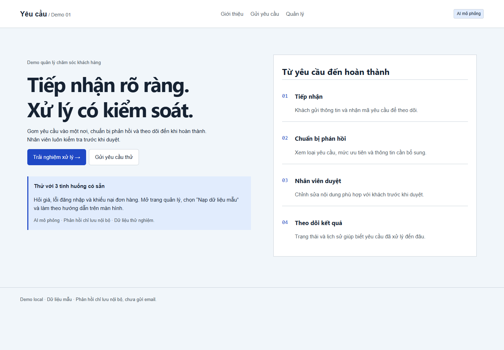
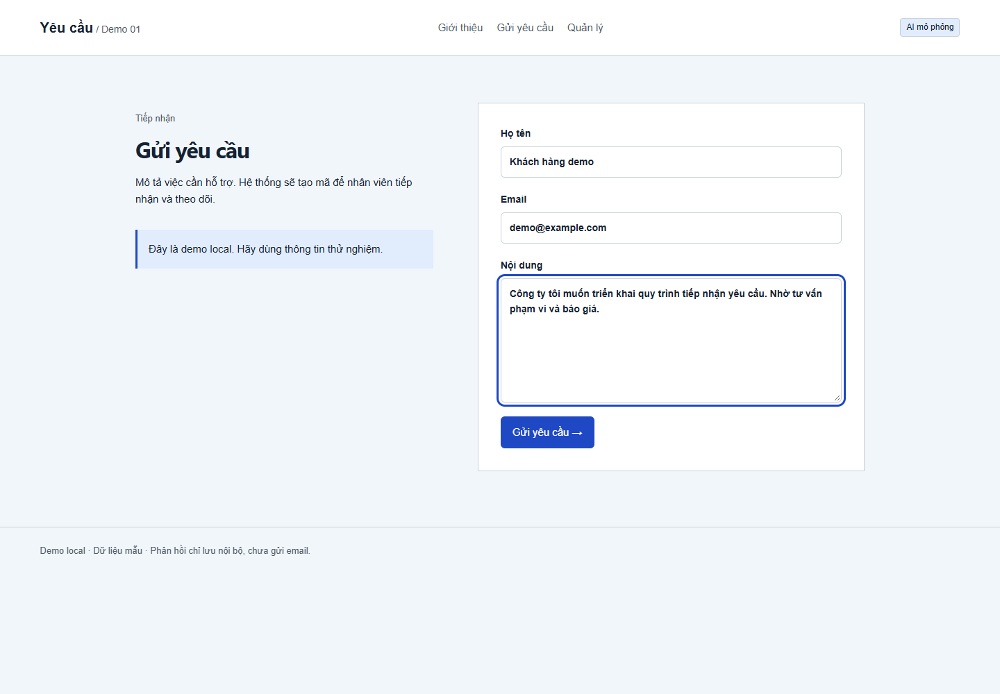
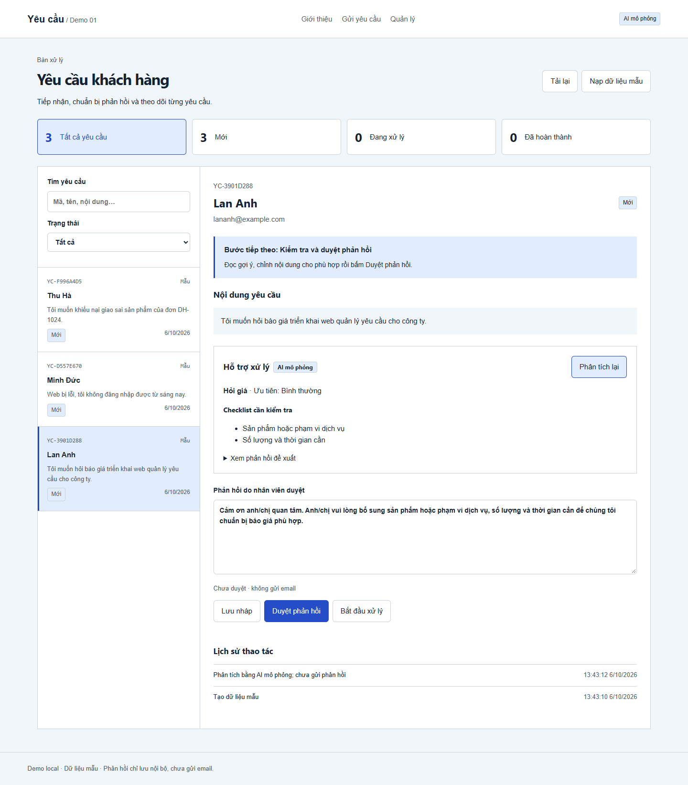
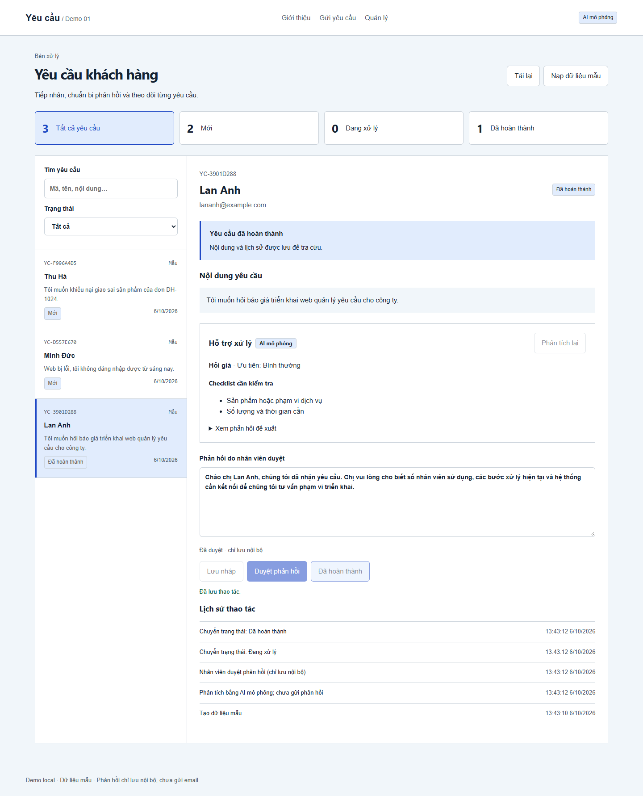
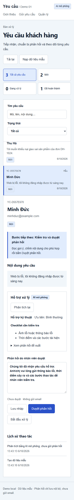

# Web xử lý yêu cầu khách hàng

**Tiếp nhận → chuẩn bị phản hồi → nhân viên duyệt → theo dõi hoàn thành.**

Demo dành cho doanh nghiệp muốn xem cách tự động hóa một phần công việc chăm sóc khách hàng trước khi trao đổi về triển khai. Khách gửi nội dung; nhân viên xem gợi ý và quyết định phản hồi cuối cùng.

> Demo local. **AI mô phỏng bằng quy tắc**, chưa gửi email, chưa kết nối CRM và chưa có đăng nhập. Ảnh bên dưới được chụp từ ứng dụng chạy thật với dữ liệu mẫu.



## Bạn có thể thử những gì?

| Tình huống | Demo hỗ trợ | Nhân viên quyết định |
|---|---|---|
| Hỏi giá | Phân loại, checklist, dự thảo phản hồi | Kiểm tra phạm vi trước khi báo giá |
| Không đăng nhập được | Gợi ý lấy thông báo lỗi và bước tái hiện | Xác nhận lỗi và phương án hỗ trợ |
| Khiếu nại đơn hàng | Đánh dấu ưu tiên cao, kiểm tra mã đơn | Xác minh sự việc và duyệt nội dung |

Mỗi yêu cầu có mã riêng, trạng thái và lịch sử. Tìm theo mã, tên, email hoặc nội dung. Sửa phản hồi sau khi duyệt sẽ yêu cầu duyệt lại.

## Xem qua màn hình thật

### Khách gửi yêu cầu

Form gồm tên, email và nội dung. Sau khi gửi, khách nhận mã yêu cầu.



### Nhân viên kiểm tra và chuẩn bị phản hồi

Bấm chỉ số để lọc trạng thái. Chọn yêu cầu và làm theo ô **Bước tiếp theo**. Phân tích luôn có nhãn **AI mô phỏng**.



### Duyệt và ghi nhận hoàn thành

Nhân viên chỉnh nội dung rồi duyệt. Phản hồi chỉ lưu nội bộ; lịch sử ghi lại các bước xử lý.



<details>
<summary>Xem giao diện điện thoại</summary>



</details>

## Chạy và tự thử

**Windows:** cài Node.js 24 trở lên → **Code → Download ZIP** → giải nén → mở `start.bat` → mở [http://127.0.0.1:3000](http://127.0.0.1:3000).

Lần đầu cần mạng để cài thư viện. Dừng bằng Ctrl+C. Nếu cổng 3000 đang dùng, dừng server cũ hoặc chạy `npm run dev -- --port 3100`.

```bash
git clone https://github.com/Boothill2001/customer-request-demo.git
cd customer-request-demo
npm ci
npm run dev
```

1. Mở **Quản lý → Nạp dữ liệu mẫu** và xác nhận.
2. Chọn **Lan Anh → Phân tích**, xem checklist và sửa phản hồi.
3. **Duyệt phản hồi → Bắt đầu xử lý → Hoàn thành**.
4. Thử **Minh Đức**, **Thu Hà**, hoặc vào **Gửi yêu cầu** để nhập nội dung riêng.
5. Đóng và mở server: dữ liệu và lịch sử vẫn còn.

Nạp lại mẫu chỉ thay yêu cầu có nhãn Mẫu, giữ yêu cầu tự nhập. Dùng dữ liệu thử nghiệm, không nhập thông tin nhạy cảm.

## Tùy chỉnh theo doanh nghiệp

Có thể điều chỉnh loại yêu cầu, ưu tiên, checklist, phản hồi và bước duyệt theo quy trình cụ thể. Email/CRM, tài khoản, phân quyền và AI thật cần triển khai và kiểm chứng riêng. Repo chưa chứng minh hiệu quả trên dữ liệu khách thật hoặc mức tiết kiệm thời gian.

## Dành cho người triển khai

**Stack:** Next.js App Router, TypeScript, SQLite tích hợp Node.js 24. `lib/ai.ts` định nghĩa `AIProvider`; thay provider ở server để gắn API thật. Không đặt key trong browser. Bộ mẫu dùng từ khóa; checklist có thể chứa thông tin khách đã cung cấp, nhân viên cần kiểm tra.

| API | Chức năng |
|---|---|
| `GET /api/tickets` | Danh sách |
| `POST /api/tickets` | Tạo từ `{name,email,content}` |
| `GET /api/tickets/:id` | Đọc yêu cầu |
| `PATCH /api/tickets/:id` | `{action:save\|approve\|advance,response?}` |
| `POST /api/tickets/:id/analyze` | Phân tích, giữ phản hồi đã chỉnh |
| `POST /api/seed` | `{confirm:true}` nạp mẫu |

Lỗi trả `{error}` với HTTP 400/404/409/500. SQLite ở `data/tickets.sqlite`; dừng server trước khi sao lưu. Biến `TICKET_DB` chọn DB riêng. Chỉnh sửa đồng thời hiện là last-write-wins.

```bash
npm test
npm run typecheck
npm run build
```

Đã kiểm tra API, bước duyệt, lưu qua restart, lỗi và thử lại; luồng trình duyệt và màn hình 320/375/414/768/1280 px. Chưa kiểm thử tải hoặc chất lượng AI thật.

`node scripts/verify.mjs` chạy với server đang bật và tạo ticket kiểm thử: dùng DB riêng. Script browser `.cjs` cần Playwright (`PLAYWRIGHT_PATH`) và trình duyệt (`BROWSER_EXE`); `BASE_URL` chọn server. Script chụp ảnh nạp lại mẫu nên chỉ dùng DB dành cho demo.

### Trước khi chạy online

Server bind 127.0.0.1. Cần thêm xác thực, phân quyền, rate limit, kiểm soát dữ liệu theo doanh nghiệp, giám sát và sao lưu trước khi public hosting.
